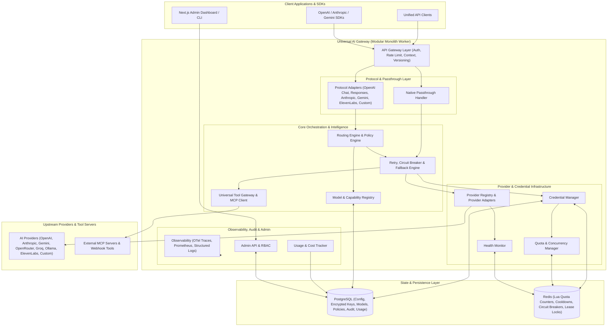
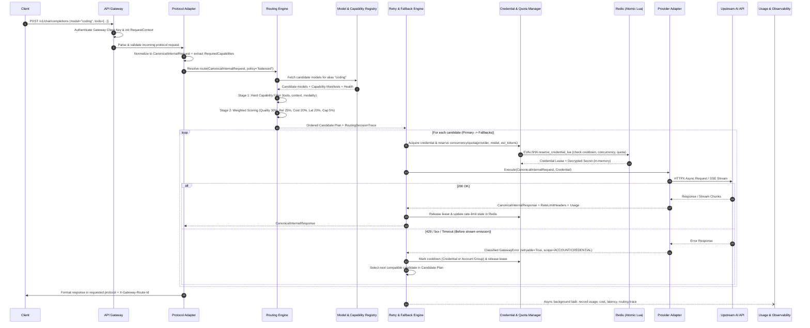

# Universal AI Gateway — System Architecture (`ARCHITECTURE.md`)

## 1. Executive Summary

The **Universal AI Gateway** is a self-hosted, production-grade, modular monolith AI infrastructure platform designed to sit between client applications and heterogeneous upstream AI providers (OpenAI, Anthropic, Google Gemini, OpenRouter, Groq, Ollama, ElevenLabs, and custom REST providers).

Unlike simple pass-through proxies or naive format translators, the Universal AI Gateway treats **provider capabilities**, **protocol semantics**, **credential quotas**, and **tool execution boundaries** as first-class architectural primitives. It operates in three explicit API integration modes:

1. **Unified API Mode**: Normalized endpoints (`/v1/universal/...` and OpenAI-compatible `/v1/chat/completions`, `/v1/embeddings`, etc.) with intelligent, policy-driven, capability-filtered model routing and cross-provider fallback.
2. **Native API Passthrough Mode**: Provider-faithful endpoints (`/v1/native/{provider}/...`) that preserve upstream request/response schemas, SSE framing, headers, and provider-specific extensions while still benefiting from multi-key rotation, quota tracking, observability, and circuit breaking.
3. **Custom Provider & Protocol Plugin Mode**: Declarative and programmatic registration of arbitrary REST AI endpoints with custom authentication schemes, JSONPath/JMESPath/template request-response transformations, streaming parsers, and error mappings.

---

## 2. Architectural Style: Modular Monolith

The system is architected as a **strictly bounded Modular Monolith** built on Python (FastAPI + SQLAlchemy 2.0 Async + HTTPX + Redis).

### Why a Modular Monolith?
- **Zero-hop internal orchestration**: Every AI gateway request traverses authentication, protocol parsing, capability resolution, routing, credential reservation, rate-limit checking, and upstream dispatch. In a microservices topology, internal RPC serialization would add 5–15 ms of latency overhead per hop. A modular monolith keeps hot-path orchestration sub-millisecond in-process while using Redis for cross-worker state coordination.
- **Strict domain isolation**: Each subsystem lives in its own top-level package (`src/gateway/<module>`) with explicit public interfaces (`interfaces.py` / `service.py`), domain models, and zero circular imports.
- **Horizontal scalability**: Any number of stateless FastAPI worker processes can run concurrently behind a load balancer, coordinating real-time concurrency reservations, rate-limit cooldowns, and circuit-breaker state through atomic Redis Lua scripts, while persisting durable configuration and audit logs in PostgreSQL.

---

## 3. Core Architectural Principles & Invariants

1. **No Fabricated Capabilities**: If a model's context window, structured output support, or vision capability is not verified by static manifest or provider discovery, it is marked `UNKNOWN`—never assumed `SUPPORTED`.
2. **No Silent Feature Dropping**: When a client requests a feature (e.g., `response_format: json_schema`, `parallel_tool_calls`, `thinking` budget, or custom voice settings) that a target model/provider does not support, Stage 1 capability filtering excludes that candidate, or in Native/explicit mode returns an explicit `422 UnsupportedCapabilityError`.
3. **Account-Aware Quota Realism**: Multiple API keys belonging to the same provider organization/account/workspace share an `account_group_id`. When the upstream provider enforces organization-wide RPM/TPM limits, a 429 on an account-scoped header cools down the shared quota bucket rather than naively cycling through sibling keys in the same throttled organization.
4. **Envelope Encryption for Credentials**: Upstream API keys are never stored in plaintext, never logged, and never returned in API responses after creation.
5. **Safe Idempotency & Retry Boundaries**: Streaming requests that have already emitted content chunks to the client, or tool calls with side effects in an indeterminate state, are never blindly replayed onto a fallback provider.

---

## 4. End-to-End Request Lifecycle

### 4.1 Unified / Routed Request Flow

### 4.2 Native Passthrough Request Flow

When a client calls `/v1/native/{provider}/{upstream_path:path}`:
1. **Authentication Interception**: The gateway authenticates the client using a Gateway API Key (passed via `X-Gateway-Api-Key` or mapped from the provider's native auth header `Authorization` / `x-api-key` / `x-goog-api-key`).
2. **Zero-Normalization Inspection**: The protocol layer performs lightweight non-destructive inspection of the payload (extracting the `model` field and `stream` boolean without stripping unknown/provider-specific fields).
3. **Credential Injection**: The `CredentialManager` selects an healthy upstream credential for `{provider}` (and `{model}` if applicable), replacing the auth header with the upstream secret.
4. **Raw Execution & Streaming**: The `ProviderAdapter.execute_native()` forwards the exact request body, query parameters, and safe headers to the upstream provider and streams raw bytes/SSE events back to the client while parsing usage metadata on-the-fly for accounting.

---

## 5. Synchronous vs. Asynchronous Communication Matrix

| Interaction | Mode | Mechanism | Rationale |
| :--- | :--- | :--- | :--- |
| Client ↔ API Gateway | Async I/O (Sync HTTP semantics) | FastAPI / Uvicorn ASGI + HTTP/1.1 & HTTP/2 SSE | High concurrency without thread-per-connection overhead. |
| Gateway ↔ Upstream AI Providers | Async I/O | `httpx.AsyncClient` with per-provider connection pools | Non-blocking streaming and concurrent tool/model requests. |
| Gateway ↔ Redis (Credential & Quota reservation) | Async I/O (Inline Hot Path) | `redis.asyncio` + pre-loaded Lua scripts (`EVALSHA`) | Atomic sub-millisecond state transitions across workers. |
| Gateway ↔ PostgreSQL (Config/Model Reads) | Async I/O + In-Memory Cache | SQLAlchemy `AsyncSession` (`asyncpg`) + TTL cache with Redis Pub/Sub invalidation | Avoids DB round-trips on the request hot path while keeping multi-worker consistency. |
| Usage Logging, Audit Events & Routing Traces | Async Background / Out-of-Band | Bounded in-memory `asyncio.Queue` + batch writer worker to PostgreSQL | Prevents database write latency or transient DB hiccups from blocking AI responses. |
| Active Health Checks (Providers, Credentials, MCP) | Scheduled Async Background | Periodic background task loop with Redis distributed lock | Probes upstream availability and recovers half-open circuit breakers off the critical path. |
| Gateway ↔ MCP Servers | Async I/O | Official `mcp` Python SDK (`stdio` subprocesses or `SSE`/`StreamableHTTP` clients) | Asynchronous tool discovery and bounded-timeout tool execution. |

---

## 6. Risk Analysis: Race Conditions, Incompatibilities & Failure Scenarios

### 6.1 Race Conditions & Mitigations
1. **Thundering Herd on Credential Selection & Concurrency Limits**:
   - *Risk*: 50 concurrent requests across 4 gateway workers simultaneously read Redis, see Credential A has `active_requests = 4` (limit 5), and all 50 pick Credential A.
   - *Mitigation*: All check-and-reserve operations (`cooldown check` + `concurrency increment` + `RPM/TPM token bucket decrement` + `last_used_at update`) execute inside a **single atomic Redis Lua script**. If a worker crashes mid-request, each in-flight reservation carries a Redis TTL lease key (`lease:{request_id}`) that auto-expires or is cleaned up by the background reaper.
2. **Stale In-Memory Registry Cache Across Workers**:
   - *Risk*: Administrator disables a compromised credential or updates a routing policy on Worker 1, while Workers 2–4 continue using cached configuration.
   - *Mitigation*: Credential status/cooldown state lives authoritatively in Redis. For PostgreSQL-backed configs (Models, Policies, Provider definitions), updates publish an invalidation event on a Redis Pub/Sub channel (`gateway:config:invalidate`) subscribed to by all workers, paired with a short local TTL (e.g., 5 seconds).
3. **Out-of-Order Rate-Limit Header Updates**:
   - *Risk*: Request A (sent at $t_1$, finishes at $t_3$) overwrites Redis remaining quota with a higher value than Request B (sent at $t_2$, finishes at $t_2.5$).
   - *Mitigation*: Redis Lua state update compares timestamps/monotonic sequence numbers and uses `min(recorded_remaining, reported_remaining)` within the same rate-limit reset window.

### 6.2 Protocol Incompatibilities & Mitigations
1. **System Prompt Placement & Multi-System Messages**:
   - *Issue*: OpenAI allows multiple `system`/`developer` messages anywhere in the array; Anthropic requires a top-level `system` parameter and strictly alternating or merged `user`/`assistant` turns; Gemini uses `systemInstruction`.
   - *Mitigation*: Protocol adapters explicitly extract and coalesce system instructions when normalizing to providers with top-level system fields, or raise a descriptive compatibility error if positional semantics would be lost and strict mode is enabled.
2. **Tool Call IDs and Argument Formats**:
   - *Issue*: OpenAI uses string JSON `arguments` with `call_id`; Anthropic uses parsed JSON `input` objects inside `tool_use` content blocks; Gemini uses `functionCall` parts (often without explicit IDs in older models or with thought signatures in newer models).
   - *Mitigation*: The `UniversalToolGateway` maintains a `NormalizedToolCall` envelope that preserves `provider_metadata` (such as Gemini thought signatures or Anthropic content block indices) alongside normalized `call_id`, `name`, and `arguments_dict`.
3. **Mid-Stream Errors (HTTP 200 Followed by SSE Error Frame)**:
   - *Issue*: Upstream returns HTTP 200 OK, streams 50 tokens, and then emits an SSE error event or drops the TCP connection.
   - *Mitigation*: Once the first content token has been flushed to the client, the `RetryAndFallbackEngine` locks out automatic mid-stream provider switching (to prevent incoherent stitched text) and emits a protocol-appropriate terminal error chunk to the client while recording a partial-stream failure in observability and health metrics.

### 6.3 Infrastructure Failure Modes
1. **Redis Unavailable**:
   - *Behavior*: The gateway degrades gracefully to **local-worker in-memory fallback** for rate-limit counters and round-robin indices (configurable `fail_open` vs `fail_closed` per deployment security policy), while emitting critical health alerts and setting `/health/ready` to degraded.
2. **PostgreSQL Unavailable**:
   - *Behavior*: Hot-path AI requests continue serving from the warm in-memory configuration cache; usage/audit records buffer in a bounded ring buffer with disk spillover log (`jsonl`) until PostgreSQL recovers; Admin write APIs return `503 Service Unavailable`.

