# Universal AI Gateway — Implementation Roadmap (`IMPLEMENTATION_ROADMAP.md`)

## 1. Phased Execution Overview

Development follows a strict sequential 9-phase engineering plan. Every phase includes unit and integration tests, documentation updates, and verification gates before advancing.

```mermaid
flowchart LR
    P1["Phase 1: Architecture & Foundation (Prompts 1-2)"] --> P2["Phase 2: Provider & Protocol Infra (Prompts 3-4)"]
    P2 --> P3["Phase 3: Multi-Key Credential Manager (Prompt 5)"]
    P3 --> P4["Phase 4: Model Registry & Intelligent Routing (Prompt 6)"]
    P4 --> P5["Phase 5: Universal Tool Gateway & MCP (Prompt 7)"]
    P5 --> P6["Phase 6: Fallback & Observability (Prompts 8-9)"]
    P6 --> P7["Phase 7: Next.js Admin Dashboard (Prompt 10)"]
    P7 --> P8["Phase 8: Full System Audit & Load Testing (Prompt 11)"]
    P8 --> P9["Phase 9: Open-Source Release Prep (Prompt 12)"]
```

---

## 2. Detailed Phase Breakdown & Verification Gates

### Phase 1 — Architecture and Repository Foundation (Completed)
- **Prompt 1 (Completed)**: Comprehensive architectural design (`ARCHITECTURE.md`, `TECHNICAL_SPECIFICATION.md`, `MODULE_DESIGN.md`, `API_DESIGN.md`, `SECURITY_DESIGN.md`, `IMPLEMENTATION_ROADMAP.md`).
- **Prompt 2 (Completed)**:
  - Initialized `pyproject.toml`, module package skeletons under `src/gateway/`, Pydantic settings (`src/gateway/config/`), SQLAlchemy 2.0 async engine & Alembic migrations, Redis async client pool with fail-open / memory fallback, HTTPX client pool manager with explicit four-phase timeouts, `structlog` with mandatory secret redaction, centralized exception handling, API versioning, `/health/live` and `/health/ready` endpoints, Dockerfile, `docker-compose.yml`, `.env.example`, `.gitignore`, `README.md`, and `CONTRIBUTING.md`.
  - **Verification Gate Passed**: `pytest` passed all 18 tests covering startup, DB connectivity, Redis connectivity, health/readiness endpoints, HTTPX connection pool management, secret redaction, and settings validation.

### Phase 2 — Provider and Protocol Infrastructure (Completed)
- **Prompt 3 (Provider Plugin Architecture — Completed)**:
  - Implemented `BaseProviderAdapter`, `ProviderRegistry`, capability manifests (`SUPPORTED` / `UNSUPPORTED` / `UNKNOWN`), error classification, usage/rate-limit extraction, and custom adapter registration with SSRF guards.
  - Implemented initial verified adapters: **OpenAI**, **Anthropic**, **Google Gemini**, **OpenRouter**, **Groq**, **Ollama**, and **ElevenLabs**.
  - **Verification Gate Passed**: Mocked HTTPX (`respx`) integration tests for every adapter covering auth, discovery, execution, streaming, rate-limit extraction, and error classification.
- **Prompt 4 (Universal Protocol Compatibility — Completed)**:
  - Implemented protocol adapters for OpenAI Chat Completions, OpenAI Embeddings, OpenAI Responses API (`/v1/responses`), Anthropic Messages API (`/v1/messages`), Google Gemini Native API (`/v1beta/models/...`), ElevenLabs Native Audio API (`/v1/text-to-speech`, `/v1/speech-to-text`, `/v1/voices`), and Custom REST Protocol plugins (`/v1/custom/{provider_id}`), plus explicit Native Passthrough (`/v1/native/{provider_id}/{path}`).
  - **Verification Gate Passed**: 37 total tests passing, including protocol compatibility tests verifying lossless native passthrough, accurate unified normalization, SSE streaming fidelity, and explicit `422 GW_UNSUPPORTED_CAPABILITY` rejection of unsupported provider capabilities or non-portable fields.

### Phase 3 — Credential Management (Completed)
- **Prompt 5 (Multi-Key Credential Manager — Completed)**:
  - Implemented `AES-256-GCM` two-tier envelope encryption (`EnvelopeEncryptor`), full credential CRUD & state machine (`ACTIVE`, `DISABLED`, `INVALID`, `COOLING_DOWN`, `TEMPORARILY_UNAVAILABLE`, `REQUIRES_ADMIN_ATTENTION`, `REVOKED`), 5 selection strategies (`ROUND_ROBIN`, `WEIGHTED`, `LEAST_ACTIVE`, `LEAST_RECENTLY_USED`, `RATE_LIMIT_AWARE`), hierarchical `QuotaManager` (`Credential`, `Workspace`, `Account`, `Model`, `Endpoint`, `Concurrency` filtered strictly by provider capability manifests), bounded exponential backoff with jitter (`RetryPolicyConfig`), RBAC-protected Admin APIs, and immutable audit logging.
  - **Verification Gate Passed**: 42 total tests passing, including cryptographic tamper detection, 429 cooldown coordination across shared `AccountGroup` workspaces, 401 auto-invalidation, non-retryable 400 checks, and secret redaction tests.

### Phase 4 — Intelligent Routing
- **Prompt 6 (Model Registry and Routing Engine)**:
  - Implement `ModelRegistry` (manual registration + provider discovery sync, explicit `UNKNOWN` capability state), model aliases (`auto`, `fast`, `coding`, `reasoning`, `balanced`, `classification`, `summarization`, `speech`, `embedding`, `vision`), Stage 1 hard capability filter, Stage 2 configurable weighted scorer (`Quality 30%`, `Reliability 25%`, `Cost 20%`, `Latency 20%`, `Capacity 5%`), `RoutingDecisionTrace` explainability, and Routing API endpoints.
  - **Verification Gate**: Deterministic routing test suite verifying capability filtering, policy weight changes, tie-breaking, and routing explanation traces.

### Phase 5 — Tool Orchestration
- **Prompt 7 (Universal Tool Gateway & MCP Integration)**:
  - Implement `NormalizedToolCall` / `NormalizedToolResult`, Tool Registry, JSON Schema input validation, permission allowlists, SSRF-guarded webhook tools, bounded timeouts, multi-round tool execution loop, and official MCP SDK integration (server lifecycle, tool discovery, invocation, permissions).
  - **Verification Gate**: Cross-provider tool-call normalization tests, multi-turn tool execution tests, MCP mock server integration tests, and security boundary tests.

### Phase 6 — Fallback and Observability
- **Prompt 8 (Reliability and Fallback Engine)**:
  - Implement per-provider/model/credential health checks, Redis-coordinated circuit breakers, `FallbackCompatibilityGuard` (enforcing mandatory capability parity and preventing mid-stream or non-idempotent replay), request cancellation propagation, and failure-injection tests.
- **Prompt 9 (Usage Analytics and Observability)**:
  - Implement TTFT & streaming duration measurement, token & USD cost estimation, OpenTelemetry tracing, Prometheus `/metrics`, redacted structured logging, and internal Analytics API endpoints.
  - **Verification Gate**: Failure simulation tests, fallback invariant tests, and metrics/trace validation tests.

### Phase 7 — Admin Dashboard
- **Prompt 10 (Management Dashboard)**:
  - Build Next.js + TypeScript + Tailwind CSS administrative dashboard covering all 12 views (Overview, Providers, Credentials, Models, Routing Policies, Client API Keys, Usage Analytics, Request Logs, Tool Registry, MCP Connections, Custom Integrations, System Settings) with RBAC and clear separation between live API data and demo/mock mode.

### Phase 8 — Testing and Production Readiness
- **Prompt 11 (Full System Testing & Audit)**:
  - Execute unit, integration, end-to-end, concurrent load, failure-injection, and security audit suites. Produce `TEST_REPORT.md`, `SECURITY_AUDIT.md`, `PERFORMANCE_REPORT.md`, and `KNOWN_LIMITATIONS.md`.

### Phase 9 — Documentation and Release
- **Prompt 12 (Open-Source Release Preparation)**:
  - Complete operator, developer, and contributor documentation, quickstart verification with a mock provider, benchmark methodology, `CHANGELOG.md`, and `LICENSE`.

