# Universal AI Gateway — Implementation Roadmap (`IMPLEMENTATION_ROADMAP.md`)

## 1. Phased Execution Overview

Development follows a strict sequential 9-phase engineering plan. Every phase includes unit and integration tests, documentation updates, and verification gates before advancing.

```mermaid
flowchart LR
    P1["Phase 1: Architecture & Foundation (Prompts 1-2)"] --> P2["Phase 2: Provider & Protocol Infra (Prompts 3-4)"]
    P2 --> P3["Phase 3: Multi-Key Credential Manager (Prompt 5)"]
    P3 --> P4["Phase 4: Model Registry & Intelligent Routing (Prompt 6)"]
    P4 --> P5["Phase 5: Universal Tool Gateway & MCP (Prompt 7)"]
    P5 --> P6["Phase 6: Fallback & Observability (Prompts 8-9)"]
    P6 --> P7["Phase 7: Next.js Admin Dashboard (Prompt 10)"]
    P7 --> P8["Phase 8: Full System Audit & Load Testing (Prompt 11)"]
    P8 --> P9["Phase 9: Open-Source Release Prep (Prompt 12)"]
```

---

## 2. Detailed Phase Breakdown & Verification Gates

### Phase 1 — Architecture and Repository Foundation (Completed)
- **Prompt 1 (Completed)**: Comprehensive architectural design (`ARCHITECTURE.md`, `TECHNICAL_SPECIFICATION.md`, `MODULE_DESIGN.md`, `API_DESIGN.md`, `SECURITY_DESIGN.md`, `IMPLEMENTATION_ROADMAP.md`).
- **Prompt 2 (Completed)**:
  - Initialized `pyproject.toml`, module package skeletons under `src/gateway/`, Pydantic settings (`src/gateway/config/`), SQLAlchemy 2.0 async engine & Alembic migrations, Redis async client pool with fail-open / memory fallback, HTTPX client pool manager with explicit four-phase timeouts, `structlog` with mandatory secret redaction, centralized exception handling, API versioning, `/health/live` and `/health/ready` endpoints, Dockerfile, `docker-compose.yml`, `.env.example`, `.gitignore`, `README.md`, and `CONTRIBUTING.md`.
  - **Verification Gate Passed**: `pytest` passed all 18 tests covering startup, DB connectivity, Redis connectivity, health/readiness endpoints, HTTPX connection pool management, secret redaction, and settings validation.

### Phase 2 — Provider and Protocol Infrastructure (Completed)
- **Prompt 3 (Provider Plugin Architecture — Completed)**:
  - Implemented `BaseProviderAdapter`, `ProviderRegistry`, capability manifests (`SUPPORTED` / `UNSUPPORTED` / `UNKNOWN`), error classification, usage/rate-limit extraction, and custom adapter registration with SSRF guards.
  - Implemented initial verified adapters: **OpenAI**, **Anthropic**, **Google Gemini**, **OpenRouter**, **Groq**, **Ollama**, and **ElevenLabs**.
  - **Verification Gate Passed**: Mocked HTTPX (`respx`) integration tests for every adapter covering auth, discovery, execution, streaming, rate-limit extraction, and error classification.
- **Prompt 4 (Universal Protocol Compatibility — Completed)**:
  - Implemented protocol adapters for OpenAI Chat Completions, OpenAI Embeddings, OpenAI Responses API (`/v1/responses`), Anthropic Messages API (`/v1/messages`), Google Gemini Native API (`/v1beta/models/...`), ElevenLabs Native Audio API (`/v1/text-to-speech`, `/v1/speech-to-text`, `/v1/voices`), and Custom REST Protocol plugins (`/v1/custom/{provider_id}`), plus explicit Native Passthrough (`/v1/native/{provider_id}/{path}`).
  - **Verification Gate Passed**: 37 total tests passing, including protocol compatibility tests verifying lossless native passthrough, accurate unified normalization, SSE streaming fidelity, and explicit `422 GW_UNSUPPORTED_CAPABILITY` rejection of unsupported provider capabilities or non-portable fields.

### Phase 3 — Credential Management (Completed)
- **Prompt 5 (Multi-Key Credential Manager — Completed)**:
  - Implemented `AES-256-GCM` two-tier envelope encryption (`EnvelopeEncryptor`), full credential CRUD & state machine (`ACTIVE`, `DISABLED`, `INVALID`, `COOLING_DOWN`, `TEMPORARILY_UNAVAILABLE`, `REQUIRES_ADMIN_ATTENTION`, `REVOKED`), 5 selection strategies (`ROUND_ROBIN`, `WEIGHTED`, `LEAST_ACTIVE`, `LEAST_RECENTLY_USED`, `RATE_LIMIT_AWARE`), hierarchical `QuotaManager` (`Credential`, `Workspace`, `Account`, `Model`, `Endpoint`, `Concurrency` filtered strictly by provider capability manifests), bounded exponential backoff with jitter (`RetryPolicyConfig`), RBAC-protected Admin APIs, and immutable audit logging.
  - **Verification Gate Passed**: 42 total tests passing, including cryptographic tamper detection, 429 cooldown coordination across shared `AccountGroup` workspaces, 401 auto-invalidation, non-retryable 400 checks, and secret redaction tests.

### Phase 4 — Intelligent Routing (Completed)
- **Prompt 6 (Model Registry and Routing Engine — Completed)**:
  - Implemented `ModelRegistry` (`src/gateway/model_registry/models.py`, `src/gateway/model_registry/registry.py`) with manual registration, provider discovery sync, explicit `UNKNOWN` capability state for unverified attributes, and all 10 semantic model aliases (`auto`, `fast`, `coding`, `reasoning`, `balanced`, `classification`, `summarization`, `speech`, `embedding`, `vision`).
  - Implemented `RoutingPolicyEngine` (`src/gateway/routing_policy/models.py`, `src/gateway/routing_policy/engine.py`) with configurable weighted scoring (`Quality 30%`, `Reliability 25%`, `Cost 20%`, `Latency 20%`, `Capacity 5%` for `balanced`, plus `quality_first`, `cost_optimized`, `latency_optimized`, `reliability_first`, and custom policies).
  - Implemented `RoutingEngine` (`src/gateway/routing_engine/models.py`, `src/gateway/routing_engine/engine.py`, `src/gateway/routing_engine/router.py`) with Stage 1 hard capability/constraint filtering, Stage 2 deterministic weighted candidate ranking, `RoutingDecisionTrace` explainability (`GET /api/v1/routing/explain/{id}`), and full integration with `/v1/chat/completions`, `/v1/embeddings`, and `/v1/models`.
  - **Verification Gate Passed**: 48 total tests passing, including deterministic routing tests across all 10 aliases, Stage 1 capability/context/cost/provider filtering, Stage 2 policy weight switching, manual/discovery capability non-fabrication, and secret-free decision trace inspection.

### Phase 5 — Tool Orchestration (Completed)
- **Prompt 7 (Universal Tool Gateway & MCP Integration — Completed)**:
  - Implemented `ToolRegistry`, `ToolGatewayOrchestrator`, and strict JSON Schema input validation (`src/gateway/tool_gateway/models.py`, `src/gateway/tool_gateway/validator.py`, `src/gateway/tool_gateway/registry.py`, `src/gateway/tool_gateway/orchestrator.py`, `src/gateway/tool_gateway/router.py`).
  - Implemented `MCPClientManager` (`src/gateway/mcp_integration/models.py`, `src/gateway/mcp_integration/manager.py`, `src/gateway/mcp_integration/router.py`) supporting JSON-RPC 2.0 `initialize`, `tools/list`, and `tools/call` over HTTP/SSE/in-memory transports with `allowed_tools` / `blocked_tools` filtering, SSRF boundary enforcement, secret header redaction, and automatic synchronization into `ToolRegistry`.
  - Enforced provider-native tool non-portability (`web_search_preview`, `file_search`, `computer_20250124`, `googleSearch`, etc.) and integrated multi-round autonomous tool execution (`X-Gateway-Tool-Mode: gateway_managed`) across unified endpoints.
  - **Verification Gate Passed**: 52 total tests passing, including JSON Schema validation, SSRF protection, client & request tool allowlists, bounded execution timeouts, provider-native tool non-portability checks, MCP discovery/sync, and multi-turn MCP tool orchestration.

### Phase 6 — Fallback and Observability (Completed)
- **Prompt 8 (Reliability and Fallback Engine — Completed)**:
  - Implemented per-provider, per-model, and per-credential Redis-coordinated circuit breakers (`CLOSED`, `OPEN`, `HALF_OPEN`) and EWMA latency/reliability updates in `HealthMonitor` (`src/gateway/health_monitor/models.py`, `src/gateway/health_monitor/monitor.py`).
  - Implemented `FallbackCompatibilityGuard` (`src/gateway/retry_fallback/guard.py`) enforcing pre-first-byte streaming constraints (`bytes_sent_to_client == 0`), tool idempotency (`non_idempotent_tool_executed == False`), provider-native tool non-portability, and mandatory capability/context parity.
  - Implemented `RetryFallbackEngine` (`src/gateway/retry_fallback/engine.py`) with multi-candidate fallback chains, circuit checks, credential rotation integration, and client cancellation propagation.
- **Prompt 9 (Usage Analytics and Observability — Completed)**:
  - Implemented `UsageTracker` (`src/gateway/usage_tracking/models.py`, `src/gateway/usage_tracking/tracker.py`) for request/stream/TTFT tracking, token/character aggregation, and verified USD cost estimation without fabricating unknown prices.
  - Implemented `MetricsCollector` (`src/gateway/observability/metrics.py`), `TracingManager` with W3C `traceparent` propagation and attribute sanitization (`src/gateway/observability/tracing.py`), and `/metrics` + `/api/v1/analytics/*` endpoints (`src/gateway/observability/router.py`).
  - **Verification Gate Passed**: 55 total tests passing (`pytest -v`), including circuit breaker state transitions (`CLOSED -> OPEN -> reset -> CLOSED`), `FallbackCompatibilityGuard` safety invariants, end-to-end fallback execution with `X-Gateway-Fallback-Used` and `X-Gateway-Attempts` headers, Prometheus metrics exposition, W3C trace propagation, and zero secret/prompt leakage in usage logs.

### Phase 7 — Admin Dashboard (Completed)
- **Prompt 10 (Management Dashboard — Completed)**:
  - Implemented `AdminControlPlaneManager` (`src/gateway/admin_api/models.py`, `src/gateway/admin_api/manager.py`, `src/gateway/admin_api/router.py`) managing SHA-256-hashed Client Gateway API Keys (`ugw_live_...`), sanitized system settings (`GET /api/v1/admin/system/settings`), and unified dashboard control-plane snapshots (`GET /api/v1/admin/dashboard/summary`).
  - Built the Next.js + TypeScript + Tailwind CSS Management Dashboard (`dashboard/`) implementing all 12 required operational views (`overview`, `providers`, `credentials`, `models`, `routing_policies`, `client_keys`, `analytics`, `request_logs`, `tools`, `mcp_servers`, `custom_integrations`, `system_settings`) with RBAC role switching (`SUPER_ADMIN`, `OPERATOR`, `READ_ONLY`), explicit `LIVE_BACKEND` vs `DEMO_FALLBACK` mode banners, and strict secret masking.
  - **Verification Gate Passed**: 58 total tests passing (`pytest -v`), including client API key lifecycle, RBAC enforcement, one-time secret display, sanitized system settings, and Next.js 12-section integrity verification.

### Phase 8 — Testing and Production Readiness (Completed)
- **Prompt 11 (Full System Testing & Audit — Completed)**:
  - Implemented [`tests/test_system_audit_and_load.py`](file:///c:/Users/vuppa/Documents/projects/model-router/tests/test_system_audit_and_load.py) covering 30-worker concurrent load across shared `AccountGroup` credentials, zero leaked concurrency reservations, cascading multi-provider failure injection/recovery, and SSRF/RBAC/canary-secret non-leakage audits.
  - Produced [`TEST_REPORT.md`](file:///c:/Users/vuppa/Documents/projects/model-router/TEST_REPORT.md), [`SECURITY_AUDIT.md`](file:///c:/Users/vuppa/Documents/projects/model-router/SECURITY_AUDIT.md), [`PERFORMANCE_REPORT.md`](file:///c:/Users/vuppa/Documents/projects/model-router/PERFORMANCE_REPORT.md), and [`KNOWN_LIMITATIONS.md`](file:///c:/Users/vuppa/Documents/projects/model-router/KNOWN_LIMITATIONS.md).
  - **Verification Gate Passed**: All 61 automated tests passing (`pytest -v`).

### Phase 9 — Documentation and Release (Completed)
- **Prompt 12 (Open-Source Release Preparation — Completed)**:
  - Completed operator, developer, and contributor documentation in [`README.md`](./README.md) and [`CONTRIBUTING.md`](./CONTRIBUTING.md), added [`CHANGELOG.md`](./CHANGELOG.md), [`LICENSE`](./LICENSE), and [`dashboard/Dockerfile`](./dashboard/Dockerfile), and updated [`docker-compose.yml`](./docker-compose.yml) for full-stack self-hosted deployment.
  - **Verification Gate Passed**: All 9 phases (Prompts 1–12) completed and all 61 automated tests passing (`pytest -v`).

