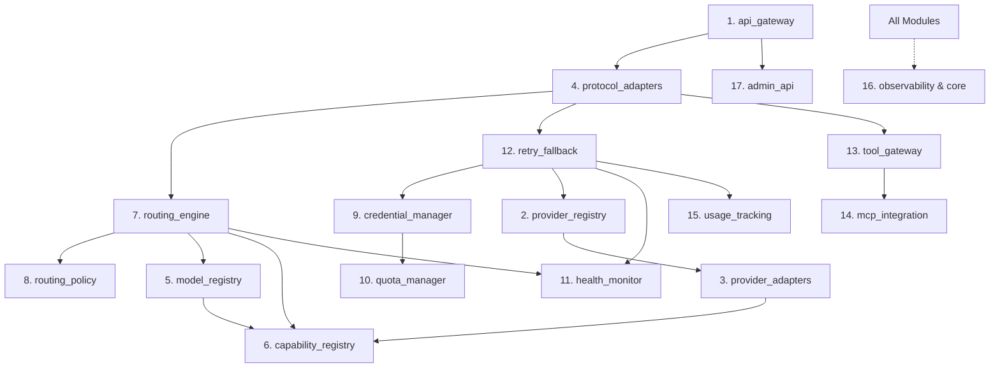

# Universal AI Gateway — Module Design (`MODULE_DESIGN.md`)

## 1. Repository & Package Structure

The backend is structured as a modular monolith under `src/gateway/`. Strict import rules enforce a Directed Acyclic Graph (DAG) of dependencies—lower-level domain modules never import higher-level orchestration or API modules.

```text
src/gateway/
├── main.py                      # FastAPI application entrypoint & lifespan manager
├── config/                      # Pydantic Settings, env validation
├── core/                        # Shared primitives, exceptions, types, crypto, db, redis, http
├── api_gateway/                 # Module 1: Client auth, rate limiting, versioning, middleware
├── protocol_adapters/           # Module 4: OpenAI Chat/Responses, Anthropic, Gemini, ElevenLabs, Custom
├── routing_engine/              # Module 7: Stage 1 filtering, Stage 2 ranking, explainability traces
├── routing_policy/              # Module 8: Policy definitions, weight validation, alias resolution
├── model_registry/              # Module 5: Model metadata, discovery sync, pricing, latency stats
├── capability_registry/         # Module 6: Provider & model capability manifests (SUPPORTED/UNSUPPORTED/UNKNOWN)
├── retry_fallback/              # Module 12: Circuit breakers, retry policies, fallback compatibility guard
├── tool_gateway/                # Module 13: Normalized tool calls, JSON Schema validation, webhook/builtin executor
├── mcp_integration/             # Module 14: Official MCP SDK client pool, discovery, lifecycle, permissions
├── credential_manager/          # Module 9: Multi-key lifecycle, envelope encryption, selection algorithms
├── quota_manager/               # Module 10: Credential/Workspace/Account/Model quota & concurrency Lua engine
├── health_monitor/              # Module 11: Active & passive health probes for providers, models, credentials
├── provider_registry/           # Module 2: Provider lifecycle, discovery, dynamic plugin loader
├── provider_adapters/           # Module 3: OpenAI, Anthropic, Gemini, OpenRouter, Groq, Ollama, ElevenLabs, Custom
├── usage_tracking/              # Module 15: Token accounting, cost calculation, async batch writer
├── observability/               # Module 16: OpenTelemetry tracing, Prometheus metrics, redacted structlog
└── admin_api/                   # Module 17: RBAC-protected management routes for dashboard & automation
```

---

## 2. Module Dependency Graph



---

## 3. Core Subsystem Interfaces & Contracts

### 3.1 Provider Adapter Interface (`provider_adapters/base.py`)

Every upstream AI service implements `BaseProviderAdapter`. The routing engine never branches on `if provider == "openai"`; it interacts strictly through this contract and the provider's `ProviderCapabilityManifest`.

```python
class BaseProviderAdapter(ABC):
    provider_id: str
    supported_protocols: frozenset[ProtocolType]

    @abstractmethod
    def get_capability_manifest(self) -> ProviderCapabilityManifest:
        """Returns verified static capabilities and quota scopes supported by this provider."""

    @abstractmethod
    async def validate_configuration(self, config: ProviderConfig) -> ValidationResult:
        """Validates endpoint URLs, auth header configuration, and required settings."""

    @abstractmethod
    async def discover_models(self, credential: DecryptedCredential) -> list[DiscoveredModel]:
        """Queries provider's model listing endpoint if supported, marking unknown fields explicitly."""

    @abstractmethod
    async def execute(
        self,
        request: CanonicalInternalRequest,
        credential: DecryptedCredential,
        timeout: TimeoutConfig,
    ) -> CanonicalInternalResponse:
        """Executes a non-streaming canonical request against the upstream provider."""

    @abstractmethod
    def execute_stream(
        self,
        request: CanonicalInternalRequest,
        credential: DecryptedCredential,
        timeout: TimeoutConfig,
    ) -> AsyncIterator[CanonicalStreamEvent]:
        """Executes a streaming canonical request and yields normalized stream events."""

    @abstractmethod
    async def execute_native(
        self,
        native_request: NativePassthroughRequest,
        credential: DecryptedCredential,
        timeout: TimeoutConfig,
    ) -> NativePassthroughResponse | AsyncIterator[bytes]:
        """Executes a zero-normalization native request while extracting rate-limit & usage telemetry."""

    @abstractmethod
    def classify_error(
        self, status_code: int, headers: Mapping[str, str], body: bytes | str
    ) -> ClassifiedProviderError:
        """Maps upstream HTTP errors to Gateway error taxonomy, retryability, and quota scope."""

    @abstractmethod
    def extract_usage_and_ratelimits(
        self, headers: Mapping[str, str], body: Mapping[str, Any] | None
    ) -> tuple[TokenUsage | None, RateLimitSnapshot | None]:
        """Extracts token/character counts and provider-specific rate-limit reset headers."""

    @abstractmethod
    async def check_health(self, credential: DecryptedCredential | None = None) -> HealthCheckResult:
        """Performs lightweight readiness/auth verification probe."""
```

### 3.2 Initial Provider Adapters & Verified Capabilities Matrix

| Provider Adapter | Native Protocols Supported | Model Discovery | Quota Scopes Tracked | Special Capabilities / Notes |
| :--- | :--- | :--- | :--- | :--- |
| **OpenAI** | `openai_chat`, `openai_responses`, `openai_embeddings`, `openai_audio` | Yes (`GET /v1/models`) | Organization/Account, Project, Model (`x-ratelimit-*`) | Native Responses API (`POST /v1/responses`) handled distinctly from Chat Completions. |
| **Anthropic** | `anthropic_messages` | Yes (`GET /v1/models`) | Workspace/Org, Model (`anthropic-ratelimit-*`) | Top-level `system`, `tool_use` blocks, extended thinking blocks, prompt caching headers. |
| **Google Gemini** | `gemini_generate_content`, `gemini_embed_content` | Yes (`GET /v1beta/models`) | Project/Account, Model (`429 ResourceExhausted` RetryInfo) | `generateContent`, `streamGenerateContent?alt=sse`, `systemInstruction`, `functionDeclarations`. |
| **OpenRouter** | `openai_chat` | Yes (`GET /api/v1/models` with rich pricing & context metadata) | Key/Account credits & rate limits | Preserves OpenRouter provider routing extensions (`provider` preferences) in passthrough. |
| **Groq** | `openai_chat`, `openai_audio` | Yes (`GET /openai/v1/models`) | Organization/Account, Model (`x-ratelimit-*`) | Ultra-low TTFT tracking; explicit limits on unsupported OpenAI fields. |
| **Ollama** | `ollama_native`, `openai_chat`, `openai_embeddings` | Yes (`GET /api/tags`, `POST /api/show`) | Local Concurrency Slot (`max_concurrency`) | Self-hosted local model server; zero token cost; concurrency-bounded queue protection. |
| **ElevenLabs** | `elevenlabs_tts`, `elevenlabs_stt`, `elevenlabs_voices` | Yes (`GET /v1/voices`, `GET /v1/models`) | Account/Tier Character Quota & Concurrency (`xi-api-key`) | Audio streaming (`output_format`), voice settings (`stability`, `similarity_boost`), STT multipart form. |

---

### 3.3 Protocol Adapter Interface (`protocol_adapters/base.py`)

Protocol adapters handle inbound client requests and outbound client responses:
1. **`OpenAIChatProtocolAdapter`**: `/v1/chat/completions`, `/v1/embeddings`, `/v1/models`.
2. **`OpenAIResponsesProtocolAdapter`**: `/v1/responses` (stateful/stateless item-based `input`, `instructions`, native `output` items, reasoning items, and `response.*` SSE events—never conflated with `chat.completion.chunk`).
3. **`AnthropicMessagesProtocolAdapter`**: `/v1/messages` (supports `anthropic-version`, `system` string or block array, `tool_use`/`tool_result` content blocks, `message_start`/`content_block_delta`/`message_delta`/`message_stop` SSE events).
4. **`GeminiNativeProtocolAdapter`**: `/v1beta/models/{model}:generateContent` and `:streamGenerateContent` (supports `contents`, `systemInstruction`, `tools.functionDeclarations`, `generationConfig`).
5. **`ElevenLabsProtocolAdapter`**: `/v1/text-to-speech/{voice_id}`, `/v1/text-to-speech/{voice_id}/stream`, `/v1/speech-to-text`, `/v1/voices`.
6. **`CustomProtocolAdapter`**: Declarative request/response mapping engine for custom REST APIs.

---

### 3.4 Custom Provider & Protocol Plugin Engine (`provider_adapters/custom_plugin.py`)

Allows developers and administrators to register custom REST AI services without modifying gateway core code:
- **Declarative JSON/YAML Plugin Manifest**:
  - `base_url`, `http_method`, `endpoint_templates` (`chat`, `embeddings`, `tts`, `health`).
  - `auth_config`: Header injection (`Authorization: Bearer {{secret}}`, custom header, query parameter, or HMAC signature).
  - `request_transform`: Safe declarative field mapping (JMESPath extraction + JSON template rendering) from `CanonicalInternalRequest` to target JSON payload.
  - `response_transform`: JMESPath extraction for output text, tool calls, finish reason, and token usage.
  - `stream_parser`: Configurable framing (`sse_json`, `ndjson`, `raw_bytes`) with JMESPath delta extractors.
  - `error_mapping`: Status code and body regex/JMESPath rules to classify retryable vs. permanent errors and extract `Retry-After`.
- **Programmatic Python Plugin Hook**: Entry-point registration (`universal_ai_gateway.plugins`) validated against `BaseProviderAdapter`.

---

### 3.5 Multi-Key Credential & Quota Manager (`credential_manager/` & `quota_manager/`)

1. **Selection Strategies**:
   - `ROUND_ROBIN`: Atomic Redis `INCR` modulo eligible pool size.
   - `WEIGHTED`: Smooth Weighted Round-Robin or weighted random proportional to `credential.weight × available_capacity_ratio`.
   - `LEAST_ACTIVE`: Selects the credential with the lowest current `SCARD ugw:cred:{id}:inflight` relative to its `max_concurrency`.
   - `LEAST_RECENTLY_USED`: Selects the credential with the oldest `last_used_ms`.
   - `RATE_LIMIT_AWARE` (Default): Combines health, zero cooldown, highest remaining quota ratio across both Credential and `AccountGroup` scopes, and least active in-flight concurrency.
2. **State Machine**:
   ```mermaid
   stateDiagram-v2
       [*] --> ACTIVE: Created & Validated
       ACTIVE --> COOLING_DOWN: HTTP 429 / Quota Exhausted
       COOLING_DOWN --> ACTIVE: Cooldown TTL Expired
       ACTIVE --> TEMPORARILY_UNAVAILABLE: HTTP 5xx / Network Timeout Threshold
       TEMPORARILY_UNAVAILABLE --> ACTIVE: Health Probe Succeeds
       ACTIVE --> INVALID: HTTP 401 Unauthorized
       ACTIVE --> REQUIRES_ADMIN_ATTENTION: HTTP 402/403 Billing or Permission Error
       ACTIVE --> DISABLED: Admin Action
       DISABLED --> ACTIVE: Admin Action
       INVALID --> [*]: Revoked / Deleted
   ```

---

### 3.6 Universal Tool Gateway & MCP Integration (`tool_gateway/` & `mcp_integration/`)

1. **Two Distinct Tool Execution Modes**:
   - **Client-Handled / Passthrough Tools**: The client passes tool definitions, the gateway normalizes them for the target model, and returns normalized `tool_calls` back to the client for execution.
   - **Gateway-Managed Autonomous/Orchestrated Tools**: Tools registered in the Gateway Tool Registry or discovered from connected **MCP Servers**. When `tool_execution_mode="gateway_managed"` (or for specific gateway-registered tools), the gateway validates arguments against the tool's JSON Schema, checks client tool permissions/allowlists, executes the tool within a strict timeout and sandbox boundary, appends the `NormalizedToolResult`, and continues the conversation loop up to `max_tool_rounds`.
2. **Non-Portability Invariant**: Provider-hosted native tools (e.g., OpenAI's built-in `web_search_preview` or `file_search`, Anthropic's server-side tools, Gemini's `googleSearch` grounding) are tagged `source_type = PROVIDER_NATIVE`. If a request requires a provider-native tool, Stage 1 routing and the Fallback Engine restrict candidate models strictly to that provider.

---

### 3.7 Reliability, Retry & Fallback Engine (`retry_fallback/`)

Before switching from failed Candidate $A$ to Fallback Candidate $B$, the `FallbackCompatibilityGuard` verifies:
1. **Stream State Check**: `bytes_sent_to_client == 0`. Once any content chunk has been yielded to the caller, fallback is aborted to prevent corrupted streams.
2. **Idempotency Check**: No gateway-managed non-idempotent tool call has completed in an uncertain state.
3. **Mandatory Capability Re-Verification**: Candidate $B$ supports all required capabilities (`tools`, `response_format`, `modalities`, `context_length >= request_tokens`).
4. **Protocol Compatibility**: If invoked via a Native API endpoint (`/v1/native/anthropic/...`), fallback is restricted to credentials/endpoints that speak the exact native protocol unless cross-provider translation was explicitly requested via Unified mode.

