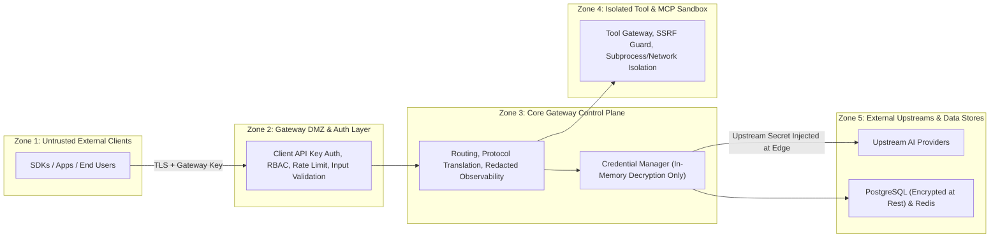

# Universal AI Gateway — Security Design (`SECURITY_DESIGN.md`)

## 1. Security Boundaries & Trust Zones

The Universal AI Gateway enforces strict isolation between five distinct trust zones:

---

## 2. Credential Security & Envelope Encryption

1. **Two-Tier Envelope Encryption (`AES-256-GCM`)**:
   - Every upstream provider credential is encrypted before touching PostgreSQL using a unique per-record 256-bit **Data Encryption Key (DEK)** via `AES-256-GCM` with a random 96-bit nonce and Associated Authenticated Data (`AAD = f"{provider_id}:{credential_id}"`).
   - The DEK itself is encrypted ("wrapped") using the master **Key Encryption Key (KEK)** loaded from the environment (`GATEWAY_MASTER_KEK_BASE64`) or external KMS.
   - **Key Rotation Support**: Multiple KEK versions (`v1`, `v2`) are supported simultaneously so master keys can be rotated without downtime.
2. **Zero-Exposure Secret Policy**:
   - Once stored, a credential's plaintext value is **never** returned by any Admin API (`GET /api/v1/admin/credentials` returns only `key_fingerprint` e.g. `sk-proj-...4f9a` and SHA-256 hash).
   - `DecryptedCredential` objects override `__repr__` and `__str__` to output `<DecryptedCredential id=... secret=[REDACTED]>`, preventing accidental exposure in Python tracebacks or local variable dumps.
   - Secrets are never cached in Redis; Redis stores only credential IDs, health states, and numeric quota counters.
3. **Ethical Quota & Terms-of-Service Compliance**:
   - The gateway **never** attempts to bypass, spoof, or evade provider rate limits, organizational bans, or account restrictions.
   - Credentials belonging to the same organization are explicitly grouped into an `AccountGroup` so shared account-level quotas are respected.

---

## 3. Authentication, Authorization & RBAC

### 3.1 Gateway Client API Keys (Data Plane)
- Format: `ugw_live_<key_id>_<random_secret>`
- Stored in PostgreSQL as **Argon2id** (or salted SHA-256 for high-speed lookup with constant-time comparison `hmac.compare_digest`).
- Scoped per client with:
  - Allowed integration modes (`unified`, `native`, `custom`)
  - Allowed models / providers
  - Allowed tools / MCP servers
  - Per-client rate limits (RPM, TPM) and monthly USD budget ceiling (`max_budget_usd`)

### 3.2 Administrative Access Control (Control Plane)
Role-Based Access Control (RBAC) enforces least privilege across Admin API routes and the Next.js Dashboard:
- **`SUPER_ADMIN`**: Full access, including credential creation/revocation, custom plugin registration, MCP server configuration, and RBAC management.
- **`OPS_ADMIN`**: Can manage routing policies, model aliases, enable/disable existing credentials, and view operational metrics.
- **`AUDITOR` / `READ_ONLY`**: Can view analytics, routing traces, audit logs, and system health; cannot mutate state or trigger credential probes.

---

## 4. Tool Execution & MCP Security

1. **No Arbitrary Command Execution**:
   - Models can never synthesize shell commands or arbitrary Python code for execution on the gateway host.
   - Only explicitly registered tools in the **Tool Registry** (and explicitly allowlisted tools from registered **MCP Servers**) can be invoked.
2. **Strict JSON Schema Validation**:
   - Before any gateway-managed tool is invoked, model-generated arguments are validated against the tool's strict JSON Schema (rejecting unexpected properties, type mismatches, or oversized payloads).
3. **SSRF & Network Isolation for Webhook Tools and Custom Providers**:
   - Any custom provider URL, webhook tool endpoint, or remote MCP SSE/HTTP URL is validated by an **SSRF Guard** that resolves DNS and blocks loopback (`127.0.0.0/8`, `::1`), link-local (`169.254.0.0/16` cloud metadata endpoints), and RFC1918 private networks (`10.0.0.0/8`, `172.16.0.0/12`, `192.168.0.0/16`) unless explicitly allowlisted for local services like Ollama (`GATEWAY_ALLOW_LOCAL_HOSTS=ollama:11434`).
4. **Stdio MCP Subprocess Hardening**:
   - Local `stdio` MCP servers can only be registered by `SUPER_ADMIN` from a pre-approved command allowlist, run with a sanitized environment (stripped of `GATEWAY_MASTER_KEK_BASE64`, `DATABASE_URL`, and upstream API keys), and enforce hard execution timeouts and output byte caps.

---

## 5. Observability Redaction & Privacy

1. **Structured Log Sanitization Processor**:
   - A mandatory `structlog` processor inspects all log events, HTTP headers, and exception payloads, redacting:
     - `Authorization`, `x-api-key`, `xi-api-key`, `x-goog-api-key`, `cookie`, `set-cookie` headers.
     - Regex patterns matching known API key prefixes (`sk-[a-zA-Z0-9_-]+`, `sk-ant-[a-zA-Z0-9_-]+`, `AIza[0-9A-Za-z-_]{35}`, `gsk_[a-zA-Z0-9]+`, `ugw_[a-zA-Z0-9_]+`).
2. **Zero Prompt/Completion Persistence by Default**:
   - By default (`GATEWAY_STORE_PROMPTS=false`), neither `request_logs` nor `routing_traces` store user message content, system instructions, or generated completions—only structural metadata (message count, token count, required capabilities, model scores) is persisted.
3. **Tamper-Evident Audit Logging**:
   - Every administrative action (creating/updating/deleting/disabling a credential, modifying routing weights, adding a custom provider, changing tool permissions) writes an immutable record to `audit_logs` with `actor_id`, `actor_ip`, `action`, `resource_type`, `resource_id`, `before_redacted_state`, `after_redacted_state`, and `timestamp`.

