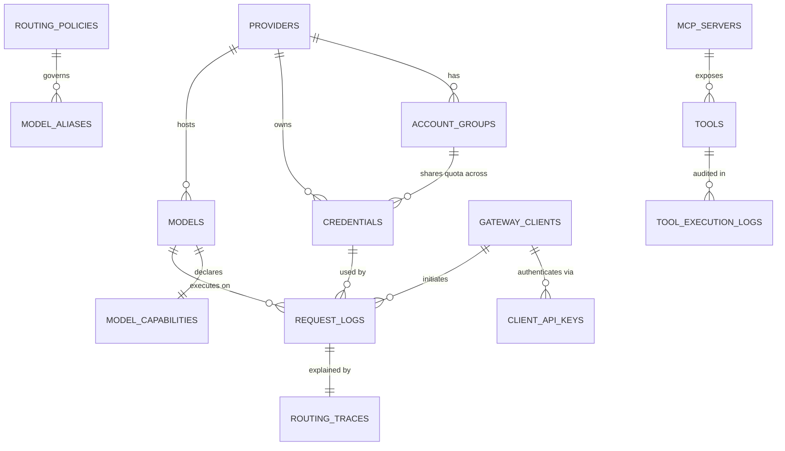

# Universal AI Gateway — Technical Specification (`TECHNICAL_SPECIFICATION.md`)

## 1. Technology Stack & Runtime Specifications

| Layer | Technology | Version / Specification | Purpose |
| :--- | :--- | :--- | :--- |
| Language & Runtime | Python | `>= 3.12` | Asyncio native task groups, strict typing (`typing`, `TypeAlias`). |
| Web Framework | FastAPI + Uvicorn | FastAPI `>= 0.115`, Uvicorn `>= 0.30` | High-performance ASGI server, OpenAPI generation, dependency injection. |
| Data Validation | Pydantic | v2 (`>= 2.9`), `pydantic-settings` | Zero-overhead Rust-backed validation, strict config parsing. |
| Database & ORM | PostgreSQL + SQLAlchemy | PostgreSQL 16, SQLAlchemy `>= 2.0` (`asyncpg`) | Durable relational storage with JSONB support for flexible manifests. |
| Migrations | Alembic | `>= 1.13` | Async-compatible schema migrations. |
| Distributed State | Redis | Redis 7.x + `redis[hiredis] >= 5.0` | Atomic Lua quota/cooldown state, distributed locks, pub/sub invalidation. |
| HTTP Client | HTTPX | `>= 0.27` (with `http2=True`) | Async connection pooling, granular timeouts, streaming iterators. |
| Cryptography | `cryptography` | `>= 43.0` | AES-256-GCM envelope encryption for stored provider credentials. |
| MCP SDK | `mcp` | `>= 1.2` | Official Model Context Protocol client (`stdio`, `sse`, `streamable_http`). |
| Observability | OpenTelemetry + Structlog + Prometheus | `opentelemetry-sdk`, `structlog`, `prometheus-client` | Distributed tracing, redacted JSON logs, `/metrics` endpoint. |

---

## 2. Database Schema Specification (PostgreSQL)

All tables include `id` (UUIDv7 or UUIDv4 primary key), `created_at` (`TIMESTAMPTZ`), and `updated_at` (`TIMESTAMPTZ`).



### 2.1 Core Tables

1. **`providers`**
   - `id`: `UUID PK`
   - `slug`: `VARCHAR(64) UNIQUE NOT NULL` (e.g., `openai`, `anthropic`, `gemini`, `openrouter`, `groq`, `ollama`, `elevenlabs`, `custom-vllm`)
   - `display_name`: `VARCHAR(128) NOT NULL`
   - `adapter_type`: `VARCHAR(64) NOT NULL` (`builtin_openai`, `builtin_anthropic`, ..., `custom_http`)
   - `base_url`: `VARCHAR(512) NOT NULL`
   - `auth_scheme`: `JSONB NOT NULL` (header name, prefix, query param, or multi-header config)
   - `supported_protocols`: `JSONB NOT NULL` (list of protocol identifiers)
   - `custom_plugin_config`: `JSONB NULL` (JMESPath/template transforms, SSE framing config for custom providers)
   - `is_enabled`: `BOOLEAN DEFAULT TRUE`
   - `health_status`: `VARCHAR(32) DEFAULT 'UNKNOWN'` (`HEALTHY`, `DEGRADED`, `UNHEALTHY`, `UNKNOWN`)

2. **`account_groups`** (Shared Quota Scope)
   - `id`: `UUID PK`
   - `provider_id`: `UUID FK -> providers.id`
   - `name`: `VARCHAR(128) NOT NULL` (e.g., `"OpenAI Tier-4 Prod Org"`, `"Anthropic Workspace A"`)
   - `external_org_id`: `VARCHAR(128) NULL`
   - `quota_Config`: `JSONB NOT NULL` (defines shared RPM, TPM, RPD, TPD, max concurrent requests across all keys in this group)

3. **`credentials`**
   - `id`: `UUID PK`
   - `provider_id`: `UUID FK -> providers.id`
   - `account_group_id`: `UUID FK -> account_groups.id NULL`
   - `label`: `VARCHAR(128) NOT NULL`
   - `key_fingerprint`: `VARCHAR(64) NOT NULL` (SHA-256 hash + masked preview `sk-...9a2f`)
   - `encrypted_secret`: `BYTEA NOT NULL` (AES-256-GCM ciphertext + nonce + tag)
   - `encrypted_dek`: `BYTEA NOT NULL` (Data Encryption Key wrapped by KEK)
   - `key_version`: `INTEGER NOT NULL DEFAULT 1`
   - `status`: `VARCHAR(32) NOT NULL` (`ACTIVE`, `DISABLED`, `INVALID`, `COOLING_DOWN`, `TEMPORARILY_UNAVAILABLE`, `REQUIRES_ADMIN_ATTENTION`)
   - `weight`: `INTEGER NOT NULL DEFAULT 100`
   - `max_concurrency`: `INTEGER NULL`
   - `quota_config`: `JSONB NOT NULL` (credential-specific limits if applicable)
   - `allowed_models`: `JSONB NULL` (optional allowlist of models for this key)

4. **`models`** & **`model_capabilities`**
   - `id`: `UUID PK`
   - `provider_id`: `UUID FK -> providers.id`
   - `canonical_model_id`: `VARCHAR(128) NOT NULL` (e.g., `openai/gpt-4o`, `anthropic/claude-3-5-sonnet-latest`)
   - `provider_model_id`: `VARCHAR(128) NOT NULL` (e.g., `gpt-4o`, `claude-3-5-sonnet-20241022`)
   - `discovery_source`: `VARCHAR(32) NOT NULL` (`MANUAL`, `PROVIDER_API`, `STATIC_MANIFEST`)
   - `supported_protocols`: `JSONB NOT NULL`
   - `input_modalities`: `JSONB NOT NULL` (`["text", "image", "audio"]`)
   - `output_modalities`: `JSONB NOT NULL` (`["text", "audio", "embedding"]`)
   - `context_length`: `INTEGER NULL` (`NULL` = `UNKNOWN`)
   - `max_output_tokens`: `INTEGER NULL`
   - `capabilities`: `JSONB NOT NULL` (Each capability mapped to `"SUPPORTED" | "UNSUPPORTED" | "UNKNOWN"`: `tool_calling`, `parallel_tool_calls`, `structured_outputs`, `json_mode`, `streaming`, `system_instructions`, `reasoning_tokens`, `vision`, `tts`, `stt`, `embeddings`)
   - `pricing`: `JSONB NOT NULL` (`input_per_1m_usd`, `output_per_1m_usd`, `cached_input_per_1m_usd`, `per_character_usd`, `currency`)
   - `quality_scores`: `JSONB NOT NULL` (task suitability scores `[0.0 - 1.0]` for `general`, `coding`, `reasoning`, `fast`, `classification`, `summarization`, `vision`, `speech`, `embedding`)
   - `is_enabled`: `BOOLEAN DEFAULT TRUE`

5. **`routing_policies`** & **`model_aliases`**
   - `id`: `UUID PK`
   - `name`: `VARCHAR(64) UNIQUE NOT NULL` (`balanced`, `quality_first`, `cost_optimized`, `latency_optimized`, `reliability_first`)
   - `weights`: `JSONB NOT NULL` (`{"quality": 0.30, "reliability": 0.25, "cost": 0.20, "latency": 0.20, "capacity": 0.05}`)
   - `constraints`: `JSONB NOT NULL` (`max_cost_per_1m_tokens`, `max_p95_latency_ms`, `min_reliability_score`, `allowed_providers`, `blocked_providers`)
   - `fallback_chain_config`: `JSONB NOT NULL` (`max_attempts`, `allow_cross_provider_fallback`)

6. **`tools`** & **`mcp_servers`**
   - `mcp_servers`: `id`, `name`, `transport_type` (`stdio`, `sse`, `streamable_http`), `endpoint_or_command`, `encrypted_auth_config`, `allowed_tools`, `status`, `timeout_ms`.
   - `tools`: `id`, `name`, `source_type` (`GATEWAY_WEBHOOK`, `GATEWAY_BUILTIN`, `MCP`, `PROVIDER_NATIVE`), `mcp_server_id`, `json_schema`, `requires_approval`, `sandbox_policy`, `timeout_ms`, `is_enabled`.

7. **`request_logs`**, **`routing_traces`**, & **`audit_logs`**
   - Stores non-sensitive request metadata (redacting prompts/completions by default unless explicitly opted in for debugging with PII scrubbing), token usage, estimated cost, TTFT, total latency, status code, error classification, and the full JSON `RoutingDecisionTrace`.

---

## 3. Redis Distributed State & Atomic Lua Contracts

All transient coordination across gateway workers uses namespace-prefixed Redis keys (`ugw:*`):

| Redis Key Pattern | Type | TTL | Purpose |
| :--- | :--- | :--- | :--- |
| `ugw:cred:{cred_id}:state` | Hash | Persistent / Synced | `status`, `cooldown_until_ms`, `consecutive_failures`, `last_used_ms` |
| `ugw:cred:{cred_id}:inflight` | Set | 300s safety TTL | Set of active `request_id`s currently holding a concurrency slot on this credential |
| `ugw:acct:{acct_id}:quota:{window}` | Hash | Window duration | Shared account-group remaining requests (`rem_req`), remaining tokens (`rem_tok`), `reset_at_ms` |
| `ugw:model:{model_id}:quota:{acct_id}` | Hash | Window duration | Model-specific rate limit tracking within an account group |
| `ugw:rr:{provider_id}:{pool_key}` | Integer | 3600s | Atomic counter (`INCR`) for round-robin credential selection |
| `ugw:cb:{target_type}:{target_id}` | Hash | 3600s | Circuit breaker state (`CLOSED`, `OPEN`, `HALF_OPEN`), failure window counters, `open_until_ms` |
| `ugw:metrics:lat:{model_id}` | Sorted Set / EWMA | 900s | Rolling P50/P95 latency and TTFT EWMA for real-time routing scoring |

---

## 4. Canonical Internal Data Model

To prevent $O(N \times M)$ translation complexity between $N$ client protocols and $M$ upstream providers, Unified API requests pass through a rich **Canonical Internal Representation (CIR)** that preserves provider-specific extensions in an explicit `extensions` envelope.

```python
class CapabilityState(StrEnum):
    SUPPORTED = "SUPPORTED"
    UNSUPPORTED = "UNSUPPORTED"
    UNKNOWN = "UNKNOWN"

class CanonicalMessagePart(BaseModel):
    type: Literal["text", "image_url", "image_base64", "audio", "tool_call", "tool_result", "thinking"]
    text: str | None = None
    media_url: str | None = None
    media_base64: str | None = None
    mime_type: str | None = None
    tool_call: NormalizedToolCall | None = None
    tool_result: NormalizedToolResult | None = None
    provider_metadata: dict[str, Any] = Field(default_factory=dict)

class CanonicalInternalRequest(BaseModel):
    request_id: UUID
    source_protocol: ProtocolType
    integration_mode: Literal["unified", "native", "custom"]
    requested_model_or_alias: str
    task_hint: str | None = None
    routing_policy_name: str | None = None
    system_instructions: list[str] = Field(default_factory=list)
    messages: list[CanonicalMessage] = Field(default_factory=list)
    tools: list[NormalizedToolDefinition] = Field(default_factory=list)
    tool_choice: ToolChoiceSpec | None = None
    response_format: ResponseFormatSpec | None = None
    temperature: float | None = None
    top_p: float | None = None
    max_output_tokens: int | None = None
    stop_sequences: list[str] | None = None
    stream: bool = False
    estimated_input_tokens: int = 0
    required_capabilities: set[CapabilityFlag] = Field(default_factory=set)
    provider_extensions: dict[str, Any] = Field(default_factory=dict)
```

---

## 5. Mathematical Specification of Two-Stage Routing

### Stage 1: Hard Capability & Constraint Filtering
Given candidate model $m \in \mathcal{M}$ and request $R$:
1. **Availability Filter**: $m.\text{is\_enabled} = \text{True}$, Provider is enabled, Circuit Breaker $\neq \text{OPEN}$, and at least one credential in $m$'s provider is eligible (not `DISABLED`, `INVALID`, or `COOLING_DOWN`).
2. **Capability Filter**: For every required capability $c \in R.\text{required\_capabilities}$:
   $$\text{Cap}(m, c) == \text{SUPPORTED}$$
   *(Note: `UNKNOWN` or `UNSUPPORTED` both fail Stage 1 hard filtering).*
3. **Context Window Filter**:
   $$R.\text{estimated\_input\_tokens} + \max(R.\text{max\_output\_tokens}, 0) \le m.\text{context\_length}$$
   *(If $R$ requires a minimum context window and $m.\text{context\_length}$ is `UNKNOWN`, $m$ is filtered out with reason `UNKNOWN_CONTEXT_LENGTH`).*
4. **Policy Hard Constraints**: Checks `max_cost_per_1m_tokens`, `max_p95_latency_ms`, and `allowed_providers` / `blocked_providers`.

### Stage 2: Normalized Weighted Candidate Ranking
For all surviving candidates $m \in \mathcal{M}_{\text{valid}}$, compute a composite score $S(m) \in [0, 1]$:

$$S(m) = w_Q \cdot Q(m, \tau) + w_R \cdot \text{Rel}(m) + w_C \cdot \text{CostScore}(m) + w_L \cdot \text{LatScore}(m) + w_{\text{Cap}} \cdot \text{CapScore}(m)$$

Where default weights are:
- $w_Q = 0.30$ (Quality / Task Suitability for task $\tau$)
- $w_R = 0.25$ (Reliability: rolling success rate $\times$ circuit health factor)
- $w_C = 0.20$ (Normalized inverse cost across candidate set: $\frac{C_{\max} - C(m)}{C_{\max} - C_{\min} + \epsilon}$)
- $w_L = 0.20$ (Normalized inverse EWMA latency across candidate set: $\frac{L_{\max} - L(m)}{L_{\max} - L_{\min} + \epsilon}$)
- $w_{\text{Cap}} = 0.05$ (Available capacity ratio across active credentials for $m$'s provider: $\frac{\text{available\_slots}}{\text{total\_slots}}$)

Ties are broken deterministically by `(S(m) DESC, CostScore(m) DESC, canonical_model_id ASC)`.

